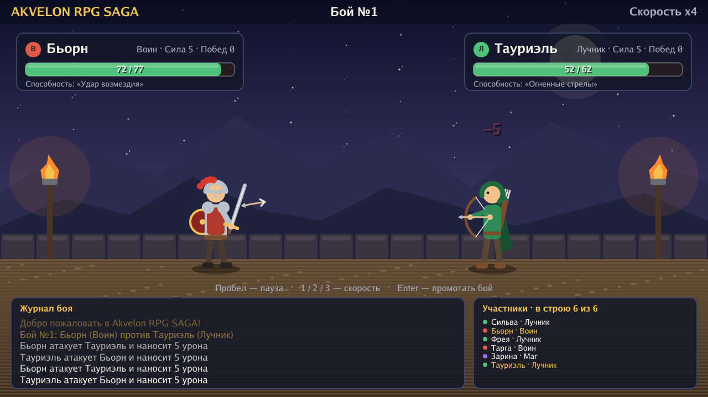
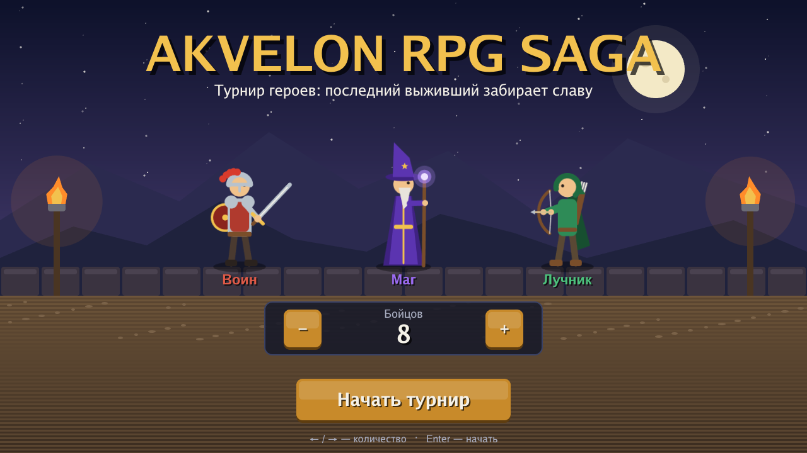
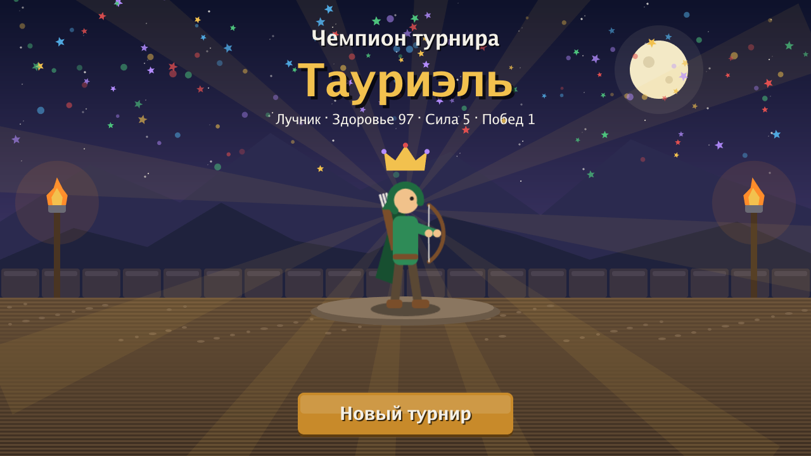

# Akvelon RPG SAGA

Турнир героев на выбывание с 2D-графикой на [Ebitengine](https://ebitengine.org/).
Воины, маги и лучники сходятся в бою один на один; проигравший выбывает, последний оставшийся становится чемпионом.



| Главное меню | Чемпион |
|---|---|
|  |  |

## Запуск

```sh
go run .
```

Нужен Go 1.25+. На Linux для сборки также понадобятся заголовки X11 и OpenGL:

```sh
sudo apt install libgl1-mesa-dev libxcursor-dev libxi-dev libxinerama-dev libxrandr-dev libxxf86vm-dev
```

## Управление

| Экран | Клавиши |
|---|---|
| Главное меню | `←` / `→` — количество бойцов (2–16), `Enter` — начать |
| Участники | `Enter` / `Пробел` — в бой |
| Бой | `Пробел` — пауза, `1` / `2` / `3` — скорость x1 / x2 / x4, `Enter` — промотать бой |
| Чемпион | `R` или кнопка — новый турнир |

Все кнопки можно нажимать мышью.

## Классы

| Класс | Способность (30% шанс) |
|---|---|
| Воин | **Удар возмездия** — урон +30% |
| Маг | **Заворожение** — противник пропускает следующий ход |
| Лучник | **Огненные стрелы** — поджигает противника (−2 HP каждый ход), раз за бой |

## Структура

- `rpg/` — игровая логика (бойцы, бой, турнир) без зависимостей от графики; каждый ход возвращает список событий.
- `main.go` — цикл игры, ввод, журнал и список участников.
- `battle.go` — сцена боя: анимации атак, снаряды, полоски здоровья.
- `scenes.go` — главное меню, карточки участников, экран чемпиона.
- `sprite.go` — векторная отрисовка персонажей.
- `fx.go`, `gfx.go` — частицы, всплывающий текст, фон арены и вспомогательные функции рисования.
